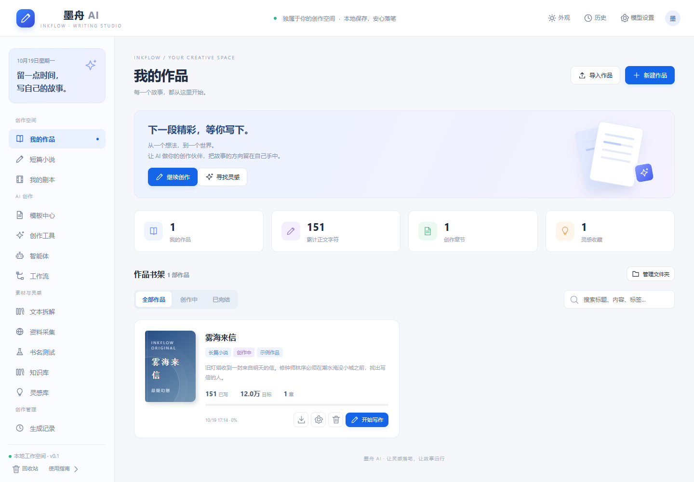

# 墨舟 AI · InkFlow Studio

本地优先的中文写作平台，适用于小说、短篇故事、分场剧本创作。提供作品书架、章节编辑、设定资料、提示词模板、AI 创作工具、智能体、多步工作流、知识库与灵感管理。

这是一套独立应用，不依赖 MedFlow WMS、MES 或其他业务系统。采用原创品牌和示例内容；参考同类平台的工作区结构，没有使用其账号、代码、用户作品或排行榜数据。

**当前版本：v0.1，本机单人版。** 文稿管理可离线使用，AI 功能需要自己的模型接口和 API Key。本项目没有多用户注册、订阅充值、社区分享、自动爬虫和联网热榜，不能直接作为公共 SaaS 上线。

## 1. 快速启动

运行环境：Windows 10/11、macOS 或 Linux；Node.js **22.13 或更新版本**，推荐使用已安装的 Node.js 22。使用 Node 内置 SQLite，不需要 npm install、Docker、外部数据库或 ChatGPT 登录。

Windows：打开项目文件夹，双击 **start.cmd**，保持终端窗口运行，在浏览器打开：

~~~text
http://127.0.0.1:5181/
~~~

也可以在 CMD 中运行：

~~~bat
cd /d D:\MedFlow\inkflow-studio
node server.mjs
~~~

macOS / Linux：

~~~sh
cd inkflow-studio
node server.mjs
~~~

首次打开会创建本地数据库、原创示例《雾海来信》、14 个写作提示词、2 个智能体、1 个写作技能和 1 条三步工作流。示例在页面上明确标注，不是你的真实作品或真实调用结果。

按 Ctrl+C 停止服务。重启后数据仍在。Node.js 22 可能输出 SQLite experimental 警告；这条警告本身不是启动失败。

## 2. 功能与边界

| 模块 | 已实现能力 |
| --- | --- |
| 作品书架 | 小说 / 短篇 / 剧本、简介、题材、目标字符数、状态、文件夹、封面配色、搜索、进度展示 |
| 章节编辑 | 多章节、约 1 秒延迟自动保存、Ctrl+S、并发版本校验、最近 80 个修改前版本、恢复历史 |
| 作品设定 | 人物、世界观、章节细纲，按作品关联，作为选中作品的模型上下文 |
| 导入导出 | UTF-8 TXT / Markdown 导入，中文章节标题拆分，整部作品导出 TXT |
| 模板中心 | 14 个内置模板；自建、编辑、分类、搜索、收藏、回收站恢复 |
| 创作工具 | 续写、润色、扩写、大纲、细纲、角色、世界观、开篇、书名简介、短篇、剧本、拆解、审校、灵感 |
| 智能体 | 自定义系统提示词、选择写作技能、关联作品与知识点，提交单次创作任务 |
| 工作流 | 自定义 1–6 步提示词，串行执行，上一步输出传递到下一步，保存分步输出，取消任务 |
| 候选稿 | 查看、复制、导出、保存到知识库；编辑器内可显式追加或替换，防重复和旧稿覆盖 |
| 知识 / 灵感 | 标题、正文、标签、作品关联、全文搜索、回收站 |
| 文本拆解 | 自己保存结构分析笔记；可用 AI“结构拆解”工具分析有权使用的文本 |
| 资料采集 | 保存来源 URL 与阅读笔记；不自动下载或抓取网页 |
| 书名测试 | 四项本地可解释规则检查，**不是**市场成绩预测、查重或模型测评 |
| 模型评测 | 用户自行记录任务体验、模型名称和评分，按个人记录统计均分 |
| 模型配置 | 兼容 OpenAI Chat Completions，服务端密钥、精确域名允许列表、超时、响应大小限制 |
| 数据管理 | SQLite 本地持久化、JSON 文稿备份与整体恢复；恢复事务失败回滚 |

智能体当前为可配置的写作助手，不是任意代码执行器；没有 MCP、工具调用循环、全电脑操作或自动联网权限。工作流是顺序提示词步骤，没有可视化 DAG、分支或定时调度。编辑器使用纯文本，不支持多人协同、富文本排版、DOCX/EPUB 导出或生成封面图片。

## 3. 配置真实模型

沿用兼容 OpenAI 格式的服务。API Key 不要贴到聊天或前端，不要上传 GitHub。

1. 在项目目录把 `.env.example` 复制为 `.env`。
2. 用记事本填写配置：

~~~dotenv
WRITING_API_KEY=填入服务商的真实密钥
WRITING_ALLOWED_HOSTS=api.openai.com,api.deepseek.com,openrouter.ai
PORT=5181
~~~

3. 如果用其他兼容服务，在 WRITING_ALLOWED_HOSTS 中添加其**精确域名**，逗号分隔。只接受公网 HTTPS，拒绝 IP、私网、带账号密码或查询参数的地址，不跟随重定向。
4. 停止并重新启动服务，使环境变量生效。
5. 打开右上角“模型设置”：填写接口根地址与服务商提供的模型 ID。接口地址例如 `https://api.openai.com/v1`，不要再加 `/chat/completions`。
6. 温度范围 0–2，单次输出上限 128–16000 Token；服务商实际限制和支持参数可能更低。
7. 保存配置，使用一个简短要求生成候选稿。没有密钥时系统明确提示配置，不会生成伪造的 AI 内容。

请求使用 POST `/chat/completions`、`stream:false`。同一时间最多两个任务，每一步等待最长约 120 秒，响应上限约 1.5 MB。当前不支持仅 Responses 格式的接口、本地 Ollama、代理凭据、自定义请求头或模型自动发现。

### 会发给模型什么

- 你填写的创作要求、所用提示词或智能体系统提示词。
- 你选择的作品名称和简介，以及该作品的人物、世界观、细纲。
- 编辑器内生成时的**当前章节**；不会自动附上整部作品全部章节。
- 手动选中的最多 8 个知识点、最多 8 个写作技能。
- 工作流上一阶段的输出。

不选其他作品，就不把其他作品作为上下文发送。模型调用产生的费用由服务商计费；取消本地等待不能保证服务商停止计算或撤销费用。

## 4. 从零完成一次创作

### 建立作品

在“我的作品”点击“新建作品”，填写名称、小说 / 短篇 / 剧本、题材、简介、目标字符数、状态和封面配色。可先通过“管理文件夹”新建文件夹，再在作品信息中归类。

示例只保留一部，避免用虚构作品数量制造空壳书架。短篇和剧本页面按类型筛选，初次使用时可能为空。

### 写章节

点击“开始写作”，在章节目录右侧点击 +。输入正文后稍等，底部应显示“已保存 · 版本 N”。Ctrl+S 可立即保存。切换章节和离开编辑器前会先保存。

保存失败时文本会保留在当前编辑框，页面会显示原因。不要直接关闭页面。多窗口同时修改同章时，后提交的旧版本被拒绝；先复制正文到本地文本，再刷新并手动合并。

章节最多 25 万字符。书架字符统计采用数据库正文长度；编辑区即时计数不计空白，数字可能有差别。历史版本是在每次成功修改前记录，保留最近 80 个，自动保存也会占用一个版本。

### 加入设定

编辑器右上角“人物 / 设定”可新增人物、世界观和细纲。这些资料绑定当前作品，生成时才加入上下文。尽量精简设定；作品上下文上限 8 万字符，超过会要求减少内容。

### 使用 AI

编辑器右侧选择续写、润色等模板，填写具体要求后生成。候选稿会在右侧出现，也可以在“生成记录”查看。点击“追加到章节”或确认“替换章节”才写入正文。

如果你在生成期间改了正文，系统会阻止自动应用候选稿；请复制结果自行比对，不要通过刷新强行覆盖。成功应用会保存原文到历史版本，且同一任务不能重复应用。

### 使用独立工具、智能体与工作流

工具页面适合不关联章节的创作任务；生成结果可复制、导出和存为知识点，不会自动改文稿。智能体可以编辑系统提示词、绑定自建技能。当前是单次任务，不是多轮聊天记录。

工作流编辑时每行一个步骤，最多六行。前一步输出会供下一步参考；“生成记录”可以展开每一步输出。任务中途失败会保留已完成步骤；当前版本重新运行会从第一步开始，不自动续跑。关闭浏览器不会停止服务端任务；关闭服务会使未完成任务在下次启动时标记为中断。

## 5. 导入、导出、备份、迁移

### 导入现有小说

“导入作品”选择 UTF-8 的 TXT 或 Markdown，单文件最多 5 MB。支持独立行的“第一章 开始”“第12章 夜行”等标题，标题后的文字需以空格分隔。没有章节标题时作为一个章节导入，单章不能超过 25 万字符。暂不支持 GBK 自动识别、PDF / DOCX 解析或 Markdown 标题层级编辑。

### 导出与恢复

- 单部作品：书架下载按钮，或编辑器“导出作品”，得到 TXT。
- 全部文稿：“模型与数据 → 导出完整文稿备份”，得到 JSON。
- JSON 备份包括作品、章节、历史版本、设定、模板、智能体、工作流及素材；**不包含** API Key、模型连接配置和生成记录。
- 恢复备份最多 30 MB，需要确认并输入“恢复备份”。恢复会整体替换当前文稿和素材，不合并；先导出当前备份。任何校验或写入失败都会回滚。
- 恢复成功后，之前的已完成任务会被标记为中断，避免把旧上下文的候选稿应用到恢复后的文稿。

### 整体搬家到另一个盘或电脑

先关闭服务，再复制整个项目文件夹，特别是 `data/` 和私有 `.env`，到新位置。只要 Node.js 满足版本要求，运行 start.cmd 即可；源码中没有硬编码 D 盘数据路径。不要在服务运行时只复制 SQLite 主文件，因为未检查点的数据可能还在 WAL 文件中。

## 6. 本地部署、安全与运维

服务固定监听 127.0.0.1，只能本机访问。用随机 HttpOnly / SameSite 会话 Cookie，校验 Host 和写入请求 Origin。没有实现账号隔离、权限角色、TLS、并发用户容量、审计合规或公共服务滥用防护。

请勿修改监听地址后直接映射公网，也不要把端口转发到外网。如果未来多人使用，需要增加真实身份验证、工作区权限、数据库迁移、多租户数据隔离、限流、备份制度和运维监控。SQLite 本地文件也没有应用层加密，保护电脑与备份文件的访问权限。

前端不展示密钥，数据库配置也不保存密钥；`.env` 在 `.gitignore` 中。生成记录含请求上下文及输出，属于你的本地创作数据，保存在 SQLite 中。域名允许列表应仅列入你信任的模型服务域名。

端口冲突时，在 `.env` 设置其他 PORT 并重启，例如 5281，使用相应 URL。停止服务后删除 `data/` 会永久清空全部文稿与记录；不建议通过删除文件解决一般启动问题。

## 7. 技术结构与开发

~~~text
inkflow-studio/
  server.mjs            Node HTTP 服务、本地会话、API、异步任务
  lib/store.mjs         SQLite、事务、版本控制、备份恢复
  lib/model.mjs         兼容模型适配、域名校验、超时和响应限制
  lib/seed.mjs          原创示例与可编辑内置模板
  dist/index.html       本地网页入口
  dist/app.js           原生 JavaScript 单页工作台
  dist/style.css        响应式蓝色创作界面
  tests/core.test.mjs   后端与模型适配测试
  tests/browser.mjs     Playwright 交互验证
  data/                 本地运行数据，不提交 Git
  .env.example          配置示例，不含密钥
  start.cmd             Windows 启动入口
~~~

技术栈：Node.js 原生 HTTP + `node:sqlite`，前端 HTML / CSS / 原生 JavaScript。运行零第三方依赖，不用安装几百 MB 的 node_modules。前端使用纯文本转义，服务器端采用参数化 SQL；静态资源仅从本地加载。

不需要构建步骤。修改文件后重启服务并刷新即可。`dist/` 是已编写的前端源码，必须提交，不能套用其他项目把 dist 全部忽略的配置。

~~~sh
node --test tests/core.test.mjs
node --check server.mjs
node --check dist/app.js
~~~

浏览器测试需要额外提供 Playwright 模块与浏览器；运行不依赖它们。Windows PowerShell 示例（按自己的实际路径填写）：

~~~powershell
$env:PLAYWRIGHT_MODULE='file:///D:/工具/node_modules/playwright/index.mjs'
$env:AGENT_TEST_BROWSER='C:/Program Files (x86)/Microsoft/Edge/Application/msedge.exe'
node tests/browser.mjs
~~~

测试使用内存数据库，不会更改你的文稿。模型测试使用模拟适配器，不会消耗真实 API 额度。

## 8. 上传 GitHub

先在 GitHub 建立空仓库 `inkflow-studio`，不预建 README 或其他文件。在项目目录执行：

~~~bat
git init
git add .
git status --short
git commit -m "feat: local-first AI writing studio"
git branch -M main
git remote add origin https://github.com/你的用户名/inkflow-studio.git
git push -u origin main
~~~

如果已有 origin，用 `git remote set-url origin 新地址`。发布前确认 `.env`、`data/` 和测试截图没有加入提交。README 和前端源码应在提交中。仓库公开可见不等于自动授予所有开源使用权；正式开源时请自行确定并加入合适的 LICENSE。

别人使用时：克隆仓库 → 安装 Node.js 22.13+ → 运行 start.cmd / node server.mjs → 按需配置自己的模型密钥。对方生成自己的数据库，不会获得你的本地文稿。

## 9. 验证记录

初版已经验证本地启动、21 项后端测试和 26 项浏览器检查。覆盖自动保存、刷新重开、候选稿显式应用、版本冲突、备份事务、任务取消、工作流传递、模板与素材页面、模型配置及手机布局。

没有真实 API Key，因此真实服务商连通性、模型输出质量、费用和长时间稳定性仍需你配置后验证。这是可运行的本地版本，不宣称已达到全部商业写作 SaaS 的功能、容量或运营水平。
